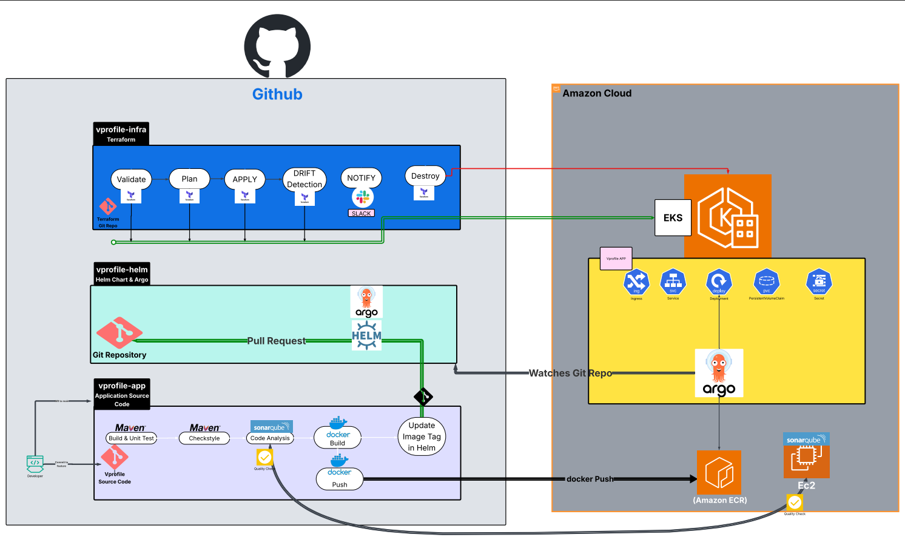
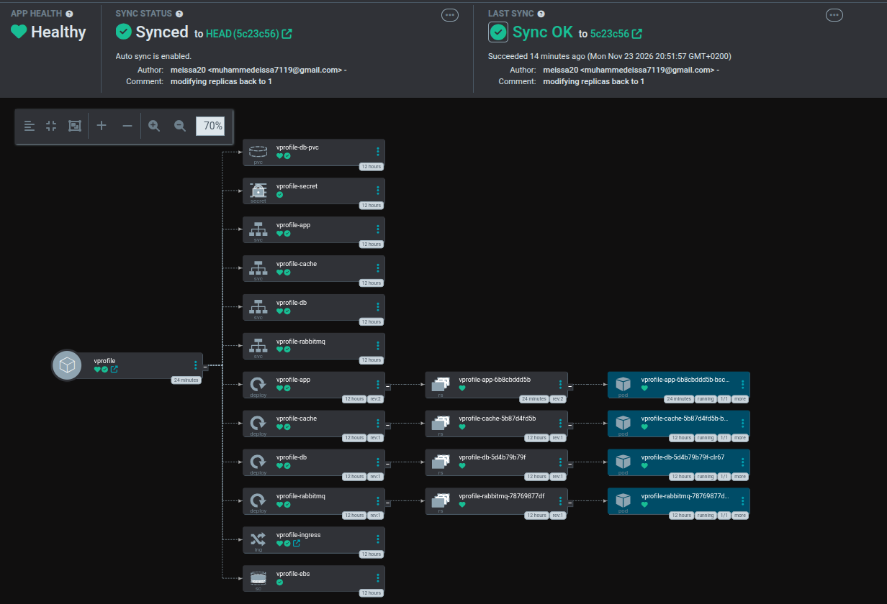
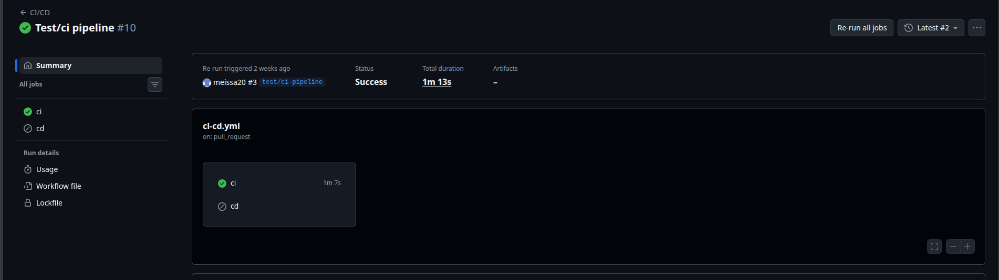
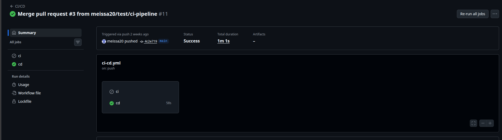
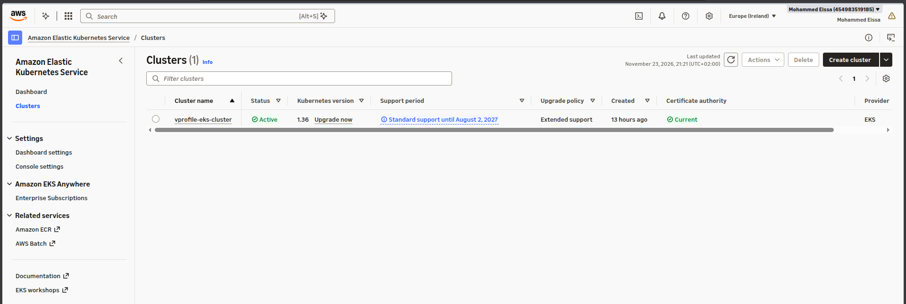
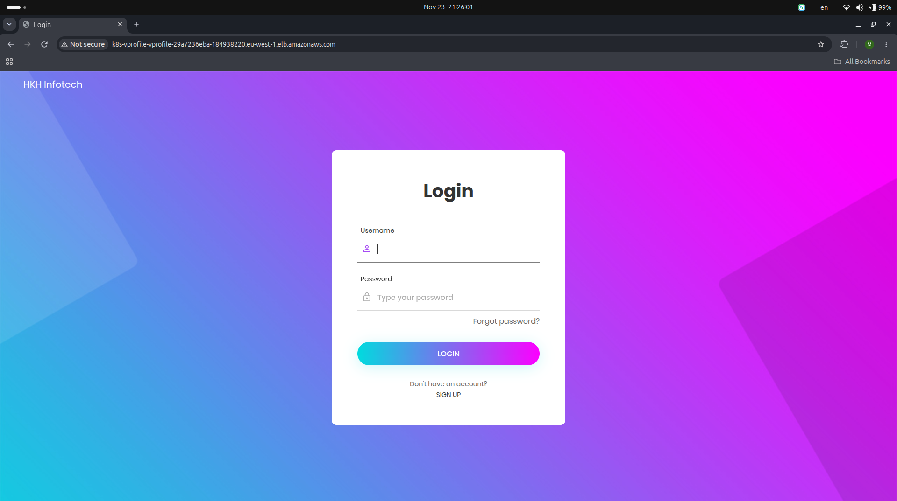

# VProfile — GitOps on Amazon EKS

An end-to-end DevOps project that **provisions AWS infrastructure with Terraform**, builds and tests a Java application, pushes Docker images to **Amazon ECR**, and deploys to **Amazon EKS** using **Helm and Argo CD**.

## Architecture

## How it works

1. **Infrastructure:** Terraform provisions and manages AWS/EKS resources; the architecture includes validation, planning, drift detection, and notifications.
2. **CI/CD:** GitHub Actions runs the application CI checks and builds/publishes container images to ECR.
3. **GitOps:** Updated Helm configuration is tracked in Git. Argo CD synchronizes the desired state to EKS.
4. **Access:** Kubernetes Ingress exposes the running VProfile application.

**Stack:** AWS · Terraform · EKS · ECR · Docker · Kubernetes · Helm · Argo CD · GitHub Actions · Maven · SonarQube

## Project in action

**Argo CD — Healthy & Synced**

**GitHub Actions — successful CI and CD runs**

**Amazon EKS — Active cluster**

**VProfile — running application**

## Repositories

| Repository | Purpose |
| --- | --- |
| [vprofile-app](https://github.com/meissa20/vprofile-app) | Application source and CI/CD |
| [vprofile-infra](https://github.com/meissa20/vprofile-infra) | Terraform infrastructure |
| [vprofile-helm](https://github.com/meissa20/vprofile-helm) | Helm chart and Argo CD configuration |
